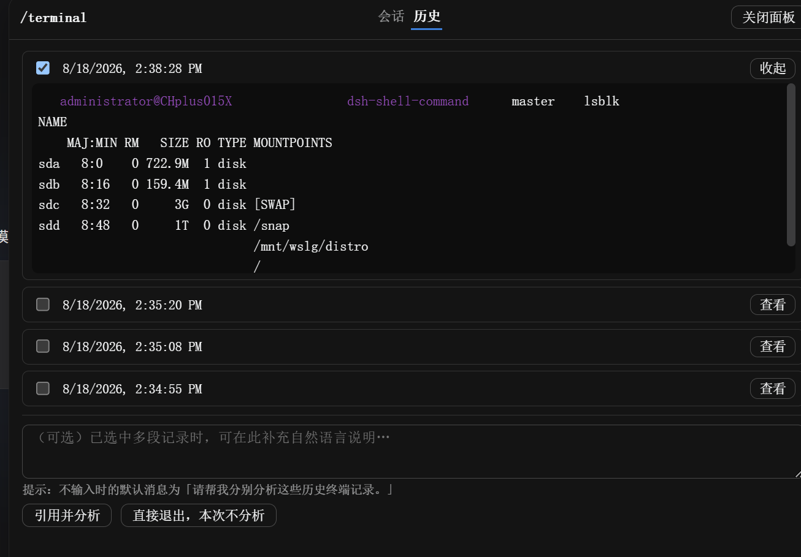

# dsh-shell-command

[English](README.md) | 中文

一个 [DeepSeek Harness](https://github.com/deepseek-ai/deepseek-harness) 插件，把 Claude Code 的 `!` 手势带到 DSH，分为两种模式：

| 命令 | 行为 |
|---|---|
| `/! <命令>` | 执行 shell 命令，分析其输出。灵感源自 Claude Code 的 `!` 前缀——在会话工作目录执行命令，并把输出交给模型即时分析 |
| `/terminal` | 弹出交互式终端窗口；关闭本身从不向模型发送任何内容——若本次会话有过输入，转录落盘后面板会跳转到「历史」Tab 并预选中这条，是否引用给模型分析由你在那里手动决定 |

**注意**：DSH 的输入触发系统只支持 `/` 和 `@` 作为触发字符，因此我们用 `/!` 而不是裸 `!` 前缀。

## 安装

需要 `dsh` CLI 与 Node `>= 22`。

```sh
# 从 npm / 仓库安装
dsh plugin --profile web add dsh-shell-command

# 本地源码（开发用 live link，客户端改动需构建后重启）
dsh plugin --profile web add "link:/path/to/dsh-shell-command"
```

安装后重启一次 Web 界面（`dsh web`）让 host 端命令加载；它会自动出现在输入框 `/` 菜单中。

### 本地 link 安装的依赖恢复

`link:` 只链接源码，不会安装源码目录的依赖。若启动时出现
`Cannot find package '@deepseek-ai/schemastery'`，先初始化 DSH web profile，
然后在本插件目录执行：

```sh
cd /path/to/dsh-shell-command
npm run setup:local
npm test
dsh web
```

初始化命令安装插件自身依赖、构建浏览器入口，再从 `${DSH_HOME:-~/.dsh}/profiles/node_modules`
链接宿主 peer 包。它检查已有链接，不会覆盖不同的 peer 包或断开的链接。
DSH 0.1.1-rc.2 的 `ui-slots` 已内置在浏览器 bundle 中，无需单独安装；
浏览器 peer 在清单中标记为 optional，仍需宿主提供对应客户端服务。

依赖已经安装时（例如离线恢复后），使用 `npm run setup:local -- --skip-install`；
该命令仍会检查插件入口、`ws` 和原生 `node-pty` 能否导入。
`node-pty` 导入成功后还需要在 Web 界面打开 `/terminal` 并执行命令验证。
macOS 上的编译失败应先检查安装日志和 Command Line Tools；ESM 导入不通过
`NODE_PATH` 查找依赖，全局安装 `schemastery` 不能替代本地初始化。

## 快速上手

### 第一次使用 `/!` 命令

在输入框输入：
```
/! df -h
```

命令立即执行，输出交给模型分析。你会看到类似的消息：

> **Shell Command Output**  
> Command: `df -h`  
> [输出内容]

模型随后分析磁盘使用情况，如发现问题会给出建议。

### 第一次使用 `/terminal` 会话

1. 在输入框输入 `/terminal`
2. 弹出浮动终端面板，有两个Tab：**会话** 和 **历史**
3. 在会话Tab尝试一些命令：
   ```
   pwd
   ls -la
   git status
   ```
4. 点击顶部的 **退出** 按钮关闭终端
5. 面板保持打开并自动跳转到 **历史** Tab
6. 刚关闭的会话已预选并展开
7. 选择后续操作：
   - 点击 **引用并分析** 将其发给模型分析
   - 点击 **直接退出，本次不分析** 跳过并关闭面板

## 命令详解

### `/! <命令>` — 单命令分析

在会话工作目录执行命令，并立即把输出交给模型分析。这是 DSH 版的 Claude Code `!` 前缀。

**何时使用：**
- 快速状态检查：`/! git status`、`/! npm test`
- 系统诊断：`/! df -h`、`/! free -h`、`/! top -bn1 | head -20`
- 文件搜索：`/! find . -name "*.log" -mtime -1`
- 一次性操作，需要立即获得 AI 洞察

**示例：**

```bash
/! git log --oneline -10
# → 模型总结近期提交，可能发现模式

/! npm run build
# → 模型分析构建输出，标记警告或错误

/! ps aux | grep node
# → 模型解释正在运行的 Node 进程
```

**技术细节：**
- 输出有界限（`maxOutputBytes`，保留尾部）并格式化用于分析
- 命令原文和生命周期记入轨迹（`command/run`/`command/done`）
- 需要活跃的模型对话（在第一条消息、模型请求之前无法使用）

### `/terminal` — 交互式终端

交互式 PTY 弹窗（持久 shell，WebSocket 实时流）。最适合：
- **探索性调试**：运行多个命令，观察行为
- **迭代测试**：修改 → 测试 → 修改 循环
- **多步骤操作**：设置 → 执行 → 验证 工作流

**工作原理：**

关闭终端**永远不会**自动向模型发送任何内容：
- 若本次会话没收到过任何输入 → 完全不留痕迹（不落盘、不进历史列表）
- 若收到过输入 → 转录落盘到 `<工作目录>/.dsh-shell-transcripts/`，面板跳转到历史Tab并预选中这条新记录

之后由你决定是否引用它进行分析（见下方历史Tab工作流程）。

#### 会话Tab特性

- **完整交互**：xterm.js 逐键接入 PTY，支持 vim、htop 和 ncurses 应用
- **控制键**：Ctrl+C 中断、Ctrl+D 发送 EOF、Ctrl+Z 挂起，由 shell 处理
- **补全与历史**：Tab 补全、↑/↓ 历史和命令行编辑使用 shell 自身功能
- **输入与显示**：支持中文输入法、粘贴、ANSI 颜色、光标移动和进度条覆盖
- **尺寸同步**：调整浮窗大小会同步终端行列数；切换到历史Tab保留现场
- **退出与断线**：shell 自然退出自动保存历史；断线后停止输入，可关闭会话再重新打开

#### 历史Tab工作流程



关闭一个收到过输入的终端会话后，面板自动切换到历史Tab：

**UI元素说明：**
1. **复选框**（左侧）：选择一条或多条历史记录用于分析
2. **时间戳**：每个会话的关闭时间
3. **查看/收起按钮**（右侧）：展开预览转录内容
4. **说明文本框**（底部）：可选的自然语言上下文，帮助模型理解
5. **默认消息提示**：显示不填写说明时模型会收到的默认消息：「请帮我分别分析这些历史终端记录。」
6. **两个操作按钮**：
   - **引用并分析**：将选中的记录发送给模型立即分析
   - **直接退出，本次不分析**：关闭面板，不向模型发送任何内容

**典型工作流程：**

```
1. 关闭终端会话（点击「退出」）
2. 面板保持打开，跳转到历史Tab
3. 刚关闭的记录已预选并自动展开
4. 查看转录预览
5.（可选）选择其他历史记录进行对比
6.（可选）在说明框添加上下文：「为什么第二次运行失败了？」
7. 点击「引用并分析」→ 模型分析选中的转录
   或点击「直接退出，本次不分析」→ 面板关闭，不向模型发送任何内容
```

**高级用法：**
- **跨运行对比**：选择 2-3 个相关会话（如修复前后）并询问：「这几次尝试之间有什么变化？」
- **引导式分析**：使用说明框引导模型注意力：「重点关注内存使用模式」
- **选择性共享**：并非每个终端会话都需要分析——只引用与当前问题相关的内容

**存储：**
- 转录持久化到 `<工作目录>/.dsh-shell-transcripts/`
- 每个会话包含：`<sessionId>-<timestamp>-<counter>.log` + `.meta.json` 元数据文件
- 保留策略：每个 session ID 保留最近 10 个会话（通过 `terminalTranscriptKeep` 配置）
- 建议将 `.dsh-shell-transcripts/` 加入 `.gitignore`

## 使用场景

### 场景1：使用 `/!` 快速诊断
```
你：构建失败了，让我检查一下...
你：/! npm run build

[输出显示 TypeScript 错误]

模型：错误表明 auth.ts 第42行缺少类型导入...
```

### 场景2：使用 `/terminal` 交互式调试
```
你：/terminal
终端：$ npm test
[测试失败]
终端：$ cat test/integration.spec.js | grep -A5 "failing test"
终端：$ ls -la test/fixtures/
终端：$ echo $NODE_ENV
[发现问题：缺少 fixture 文件]
终端：[点击「退出」]

[面板跳转到历史Tab，记录已自动选中]

你：[添加说明：「这个测试为什么失败？」]
你：[点击「引用并分析」]

模型：根据转录，测试失败是因为 test/fixtures/user-data.json 文件缺失...
```

### 场景3：对比多次运行
```
[运行1：/terminal → 安装依赖 → 检查构建时间 → 退出]
[运行2：/terminal → 启用缓存后相同步骤 → 退出]
[运行3：/terminal → 不同 Node 版本相同步骤 → 退出]

[在历史Tab]
你：[勾选全部3条记录]
你：[添加说明：「哪个配置最快，为什么？」]
你：[点击「引用并分析」]

模型：对比三次构建运行：运行2因为 npm 缓存快了3倍...
```

## 使用技巧与最佳实践

- **选择合适的工具**：单命令且需要立即反馈用 `/!`；探索性工作流程且稍后决定是否分析用 `/terminal`
- **空会话不持久化**：打开 `/terminal` 但没输入任何命令，不会创建历史记录（这是设计如此，避免混乱）
- **补全与历史**：在终端中使用 Tab 和 ↑/↓；历史保存策略由当前 shell 配置决定
- **说明增加上下文**：好的说明（「对比错误信息」或「关注性能指标」）帮助模型更有效地分析
- **选择性分析**：不必分析每个终端会话——只引用与当前问题相关的内容
- **历史是每个会话独立的**：每个 DSH 对话有自己的终端历史；它们不会混在一起

## 配置

通过 profile 的 `cordis.patch.yml` 配置（Web 设置页不暴露第三方插件设置）：

```yaml
- insert:
    - id: shell-command
      name: dsh-shell-command
      config:
        shell: ''            # '' → POSIX 用 /bin/bash，Windows 用 cmd.exe
        shellArgs: []        # [] → POSIX 用 -lc，Windows 用 /d /s /c
        timeoutMs: 60000     # 硬超时，到期终止整个进程树
        maxOutputBytes: 32768  # /! 命令的输出尾部保留量
        graceMs: 3000
        analysisPrompt: ''   # '' → 内置提示词；支持 {command} {cwd} {output} 占位符
        terminalEnabled: true
        terminalMaxTranscriptBytes: 1048576   # 内存转录上限（保留尾部）
        terminalTranscriptDir: '.dsh-shell-transcripts'
        terminalTranscriptKeep: 10
```

## 安全

- 在会话工作目录（`agent.session.header.cwd`）执行
- 优先走 harness 的 `ctx.subprocess` 接缝：环境已清洗（不泄漏 `DEEPSEEK_API_KEY`/`DSH_*`），进程树级 `SIGTERM → grace → SIGKILL` 终止；缺失时回退 `node:child_process`（同样清洗环境）
- `/!` 命令的每个流输出有界（`maxOutputBytes`，超限保留尾部）
- 设计上由人驱动：命令原文记入轨迹（`command/run`），无沙箱审批步骤——与你自己在终端敲命令权限一致

## 测试

```sh
node test/unit.mjs           # 纯解析/格式化测试，零依赖
node test/smoke.mjs          # 完整 apply() + handler，跑在 mock context 上
node test/smoke-terminal.mjs # 终端注册表 + hasInput 追踪 + 历史引用 RPC（mock）
```

smoke 测试需要真实解析 `@deepseek-ai/*` 依赖；在 profile 外运行时先软链一次：

```sh
mkdir -p node_modules/@deepseek-ai
ln -s "$HOME/.dsh/profiles/node_modules/@deepseek-ai/"* node_modules/@deepseek-ai/
```

### 客户端构建与交互验收

客户端源码位于 `src/`，`lib/client.js` 是提交并随包分发的生成文件。
源码构建使用 tsdown，需要 Node 22.18+、24.11+ 或 26+；已发布包的运行环境仍支持 Node >=22。
修改客户端后执行：

```sh
npm run build
npm test
npx playwright install chromium
npm run test:browser
```

构建使用 tsdown，xterm、FitAddon 与 CSS 都打入同一个 DSH 加载器入口，React 和
DSH 服务由宿主提供。浏览器测试在临时目录中启动真实 bash PTY，并测试实际生成的
客户端；需要 Chromium 和本机监听权限。可用时同时验证 vim/htop。
可用 `PLAYWRIGHT_CHROMIUM_EXECUTABLE_PATH` 指定已安装的 Chromium。
本地初始化也会构建源码；仅安装已发布包时直接使用随包产物。

## 常见问题 FAQ

**问：何时该用 `/!` 而非 `/terminal`？**  
答：单命令且需要立即 AI 分析时用 `/!`（状态检查、快速诊断）。需要运行多个命令并稍后决定是否分析时用 `/terminal`（交互式工作流程）。

**问：为什么我的终端会话没出现在历史Tab？**  
答：空会话（没收到输入）不会持久化。如果你打开了 `/terminal` 但没输入任何命令，不会创建历史记录。这是设计如此，避免混乱。

**问：历史转录存储在哪里？**  
答：在 `<工作目录>/.dsh-shell-transcripts/`，每个会话一个 `.log` 文件加一个 `.meta.json` 元数据文件。建议将此目录加入 `.gitignore`。旧记录会自动清理（默认：每个会话保留最近10条）。

**问：可以手动删除历史记录吗？**  
答：可以，直接从 `.dsh-shell-transcripts/` 删除对应的 `.log` 和 `.meta.json` 文件。历史Tab每次打开时从磁盘读取。

**问：可以运行 vim/htop/ncurses 吗？**
答：可以。会话Tab使用 xterm.js，按键直接发送给 PTY；程序需要安装在宿主机器上。

**问：方向键命令回顾会跨会话持久化吗？**  
答：↑/↓ 使用 shell 自身历史。是否写入历史文件、是否跨会话保留，由 shell 的配置决定。

**问：「引用并分析」和直接在对话中问命令有什么区别？**  
答：「引用并分析」会发送你的说明，以及选中转录的文件路径、时间戳和退出码，并要求模型读取这些文件中的原始输出。在对话中问依赖你的描述，可能会遗漏细节。

**问：可以引用之前 DSH 对话的转录吗？**  
答：不可以。终端历史是会话级别的。每个 DSH 对话有自己的 `.dsh-shell-transcripts/` 命名空间，历史Tab只显示当前 session ID 的记录。

**问：如果输出非常长会怎样？**  
答：`/!` 和 `/terminal` 都有输出大小限制（`maxOutputBytes` / `terminalMaxTranscriptBytes`）。超限时保留**尾部**（不是头部）。这确保最近的输出始终可见。

**问：为什么 `/!` 提示「No model request exists yet」？**  
答：`/!` 需要活跃的模型对话。先向模型发送至少一条消息（开始对话），然后 `/!` 就能用了。这是为了避免 UI 渲染时序问题。

## 已知限制

- `/!` 的输出作为 plugin 来源的消息交付（在对话中可见）
- 历史文件保存有界的原始终端字节，包含光标和全屏控制序列；历史预览用于查看日志，不是屏幕录像。
- 刷新页面后从有界转录回放；发生截断时，无法保证还原全部先前的光标或全屏状态。
- API 面锁定 `@deepseek-ai/dsh` `0.1.0-rc.x`；升级 DSH 时需锁定 peer 并回归

## 未来优化方向

我们计划在后续版本中进行以下改进：

### 国际化支持（i18n）
- 多语言 UI 支持（英文、中文等）
- 从用户偏好自动检测语言
- 可配置的 UI 标签

### 其他改进
- 命令输出的语法高亮
- 会话导出/导入
- 终端历史内搜索
- 自定义键盘快捷键

## 贡献

欢迎贡献！你可以：
- 🐛 [报告 bug 或提出功能请求](https://github.com/CHplus0/dsh-shell-command/issues)
- 🔧 提交 pull request
- 📖 改进文档
- 💡 分享你的使用场景和反馈

## License

MIT
